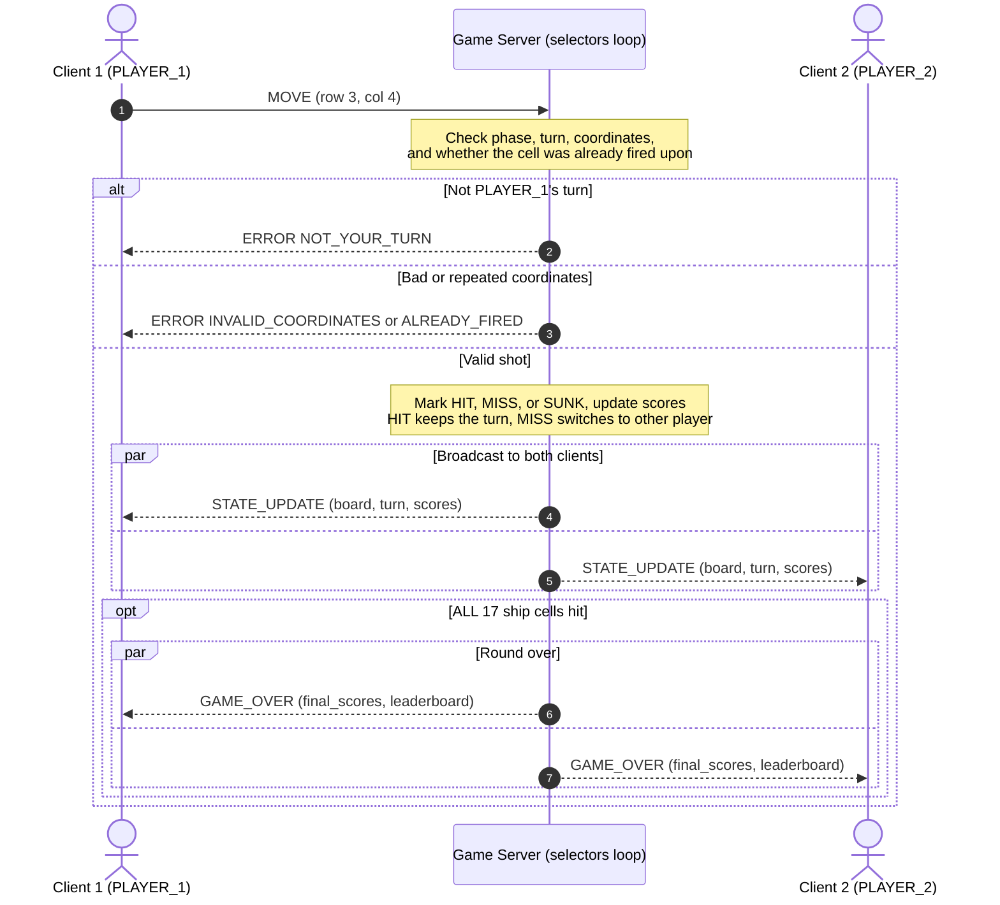

# Server Concurrency Architecture and State Synchronization for Battleship

**Author:** Brady Langerman
**Game:** 2 player Battleship over TCP
**Date:** 10-18-2026

## 1. Concurrency Model: Option B: Non-Blocking I/O Multiplexing with selectors. 

The server is **one process with one thread** running an event loop on `selectors.DefaultSelector()`. For linux, it uses `epoll` and on macOS, it uses `kqueue`. Each socket is non-blocking (`sock.setblocking(False)`), and the OS tells the loop which sockets are ready to read or write. 

**Connection Lifecycle**

1. **Listen:** create a TCP socket, `bind()`, `listen()`, `setblocking(False)`, and register it with `EVENT_READ`.
2. **Accept:** once the listening socket is readable, `accept()` the client, set it to not block, and register it with a session object holding an input buffer (`bin`) and an output buffer (`bout`).
3. **Register player:** the first `CONNECT` becomes PLAYER_1 (gets `LOBBY_WAIT`). The second becomes PLAYER_2, and both get `GAME_START`. A third player trying to join gets `ERROR GAME_FULL` and is closed. 
4. **Service:** the loop calls `sel.select(timeout = 1.0)`. On `EVENT_READ` it then calls `recv()`, splits complete messages on `\n`, and handles each one. On `EVENT_WRITE` it calls `send()` for what is waiting in `bout`. The 1 second timeout lets the loop check the 120 second turn limit.
5. **Teardown:** on `DISCONNECT`, `recv()` returning `b""`, or a socket error, call `sel.unregister()` and `close()`, and then send the other player `GAME_OVER` (FORFEIT). Then, reset the game for another round.

## 2. Thread Safety: Event loop state isolation

**Shared resources:** the board and shot grids, the active `turn`, the connected clients with a list, `scores`, `ships_remaining`, and the `leaderboard`.

**Why there aren't any race conditions:**
- Only one thread exists, so only one handler runs at a time, which makes it that no locks are required.
- Each message is validated fully, applied, and broadcast in one handler call before the event loop moves on.
- If both players send at the same exact moment, then `select()` returns both sockets, but they are handled one after another, instead of at the same time. The second always sees the updated state.
- Handlers never block (no `sendall()` or `sleep()`). Outgoing data goes into each clients' `bout`, so a slow client isn't able to freeze the whole game.

## 3. Turn enforcement and broadcast

Only the server decides whose turn it actually is. A `MOVE` is rejected with an `ERROR` to the sender only, without any state change, if:
- It's the wrong phase (`WRONG_PHASE`),
- It isn't the sender's turn (`NOT_YOUR_TURN`),
- The coordinates are outside 0-9 (`INVALID_COORDINATES`), or
- The cell was already fired at (`ALREADY_FIRED`).

A shot considered valid updates the scores and the board. A HIT keeps the turn and a MISS passes it. Then, one `STATE_UPDATE` is built one time and queued to both clients in the same handler, so both clients always receive the same exact state, in the same order.

## 4. Score and leaderboard synchronization

`scores` (hits this round) and `ships_remaining` are stored for each player in the server's game state and sent in every `STATE_UPDATE`. A `leaderboard` dict (alias to rounds won) is kept separately, so it can survive between rounds. When all 17 ship cells are hit, the server adds the win to `leaderboard` and broadcasts one `GAME_OVER` with `final_scores` and `leaderboard` to both clients that are playing. 

## 5. Sequence Diagram

**Process:** PLAYER_1 sends a `MOVE`. The server then checks the move and the valid turn. An invalid or out of turn move results in an `ERROR` sent only to PLAYER_1, and nothing else changes. A valid move updates the scores and board, and one `STATE_UPDATE` is sent to both players together. When the final ship cell is targeted and hit, `GAME_OVER` with the final scores and leaderboard is sent to both players. 